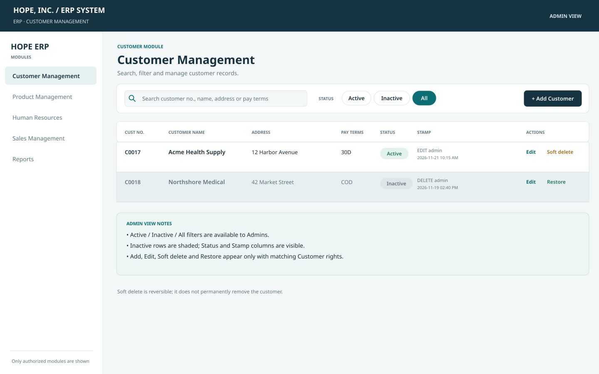
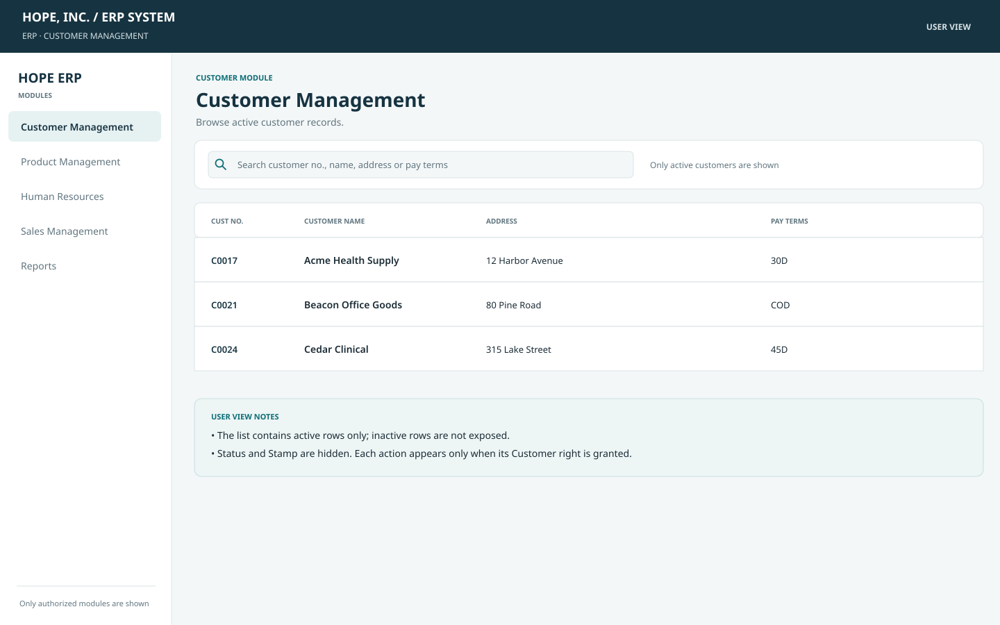
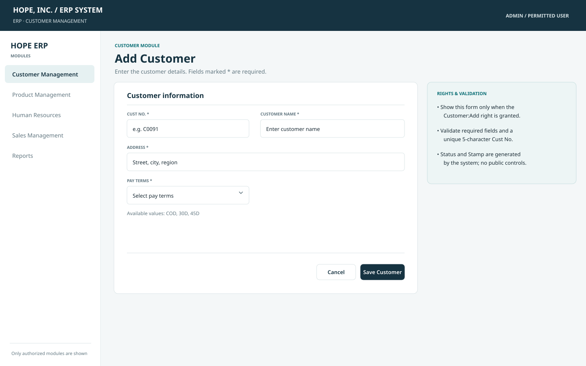
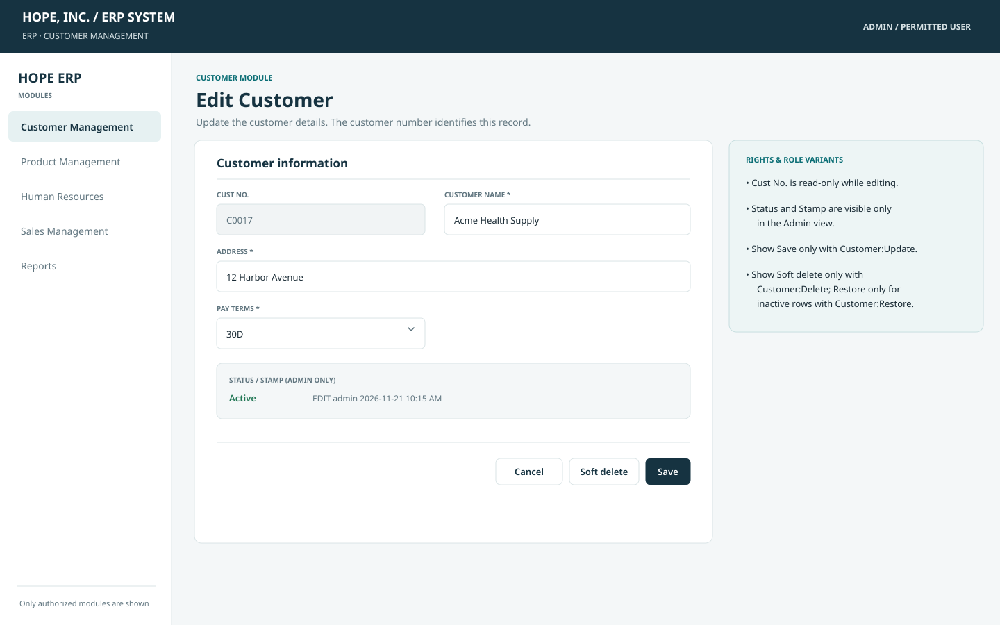

# S2-UIX-01 — Customer wireframes

**Issue:** [#161 — Wireframes: customer screens](https://github.com/zurielzantua/Hope-Inc.-Midterm-Project/issues/161)

## Screens

### Customer List — Admin

Active/Inactive/All filter, Status and Stamp columns, shaded inactive rows, and per-right actions.

### Customer List — User

Active rows only; Status and Stamp hidden; actions shown only for granted rights.

### Add Customer

Cust No., Customer Name, Address and Pay Terms. Required fields and unique 5-character customer number are annotated.

### Edit Customer

Cust No. is immutable. Status and Stamp are Admin-only. Delete and Restore use separate rights and soft deletion.

## Shared behavior

Use the existing HOPE ERP palette and Aptos-based type. The sidebar lists Customer, Product, Human Resources, Sales and Reports; implementation should display only modules permitted to the signed-in role. User lists never show soft-deleted records. Admin inactive rows are shaded. Add, Edit, Soft delete and Restore controls are conditional on their corresponding Customer rights.

These PNG wireframes are visual handoff previews. They describe screen states; they do not imply the Customer module is implemented or tested.
