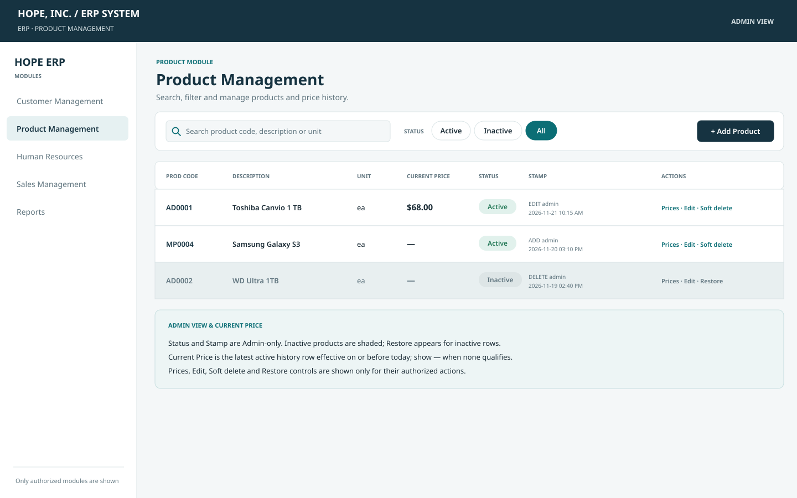
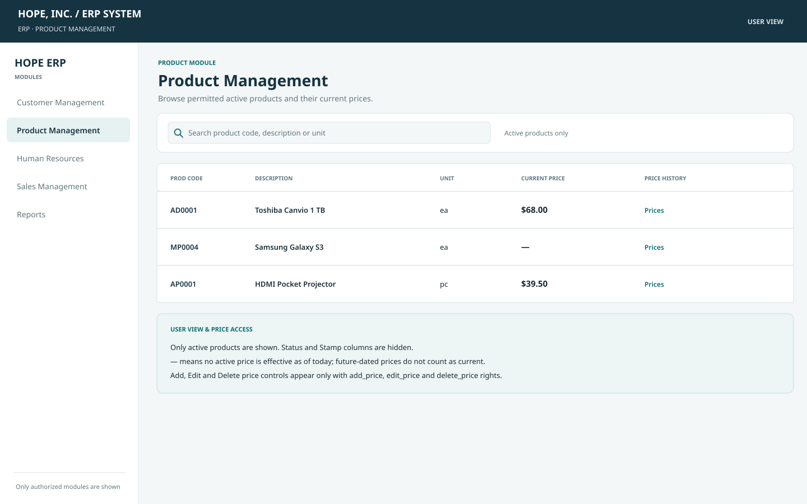
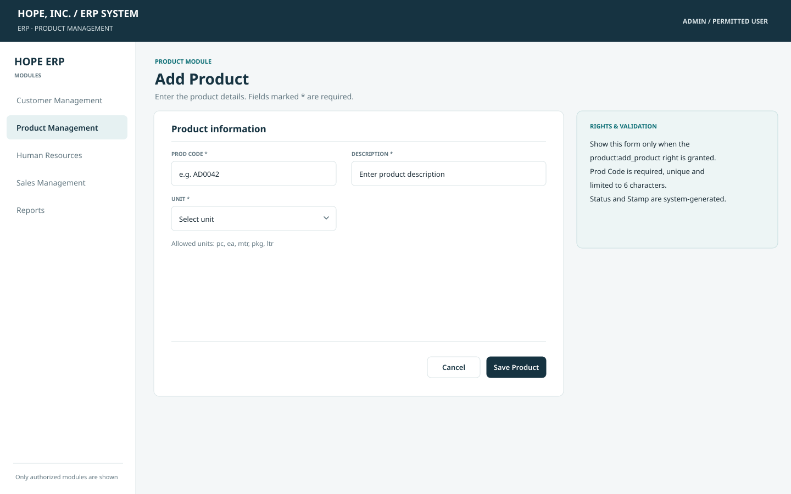
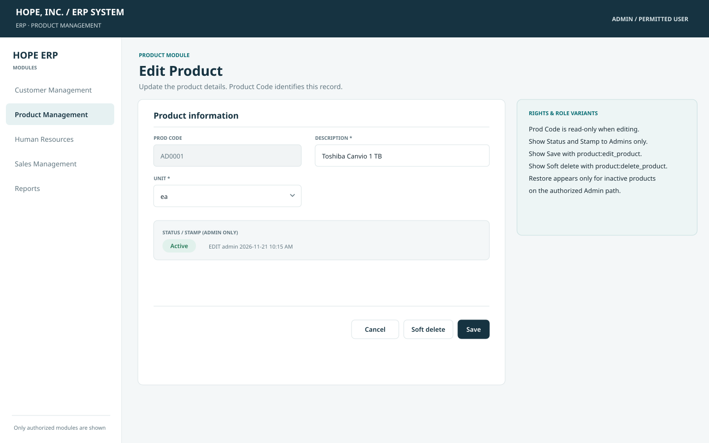
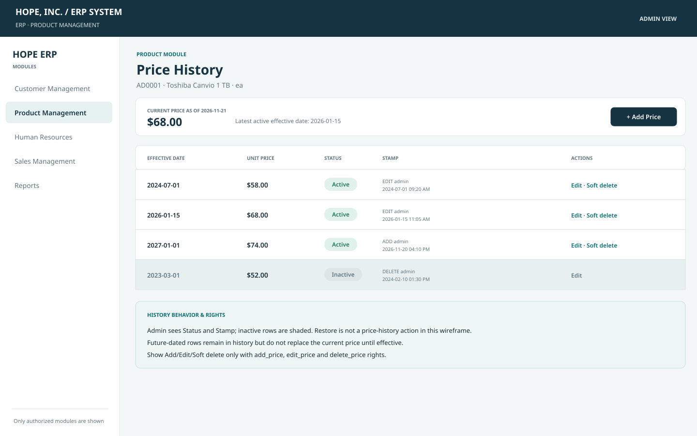
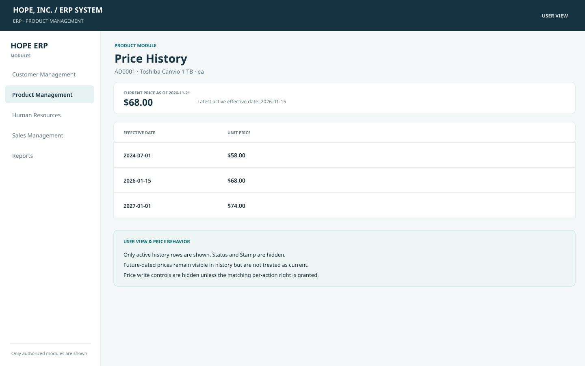
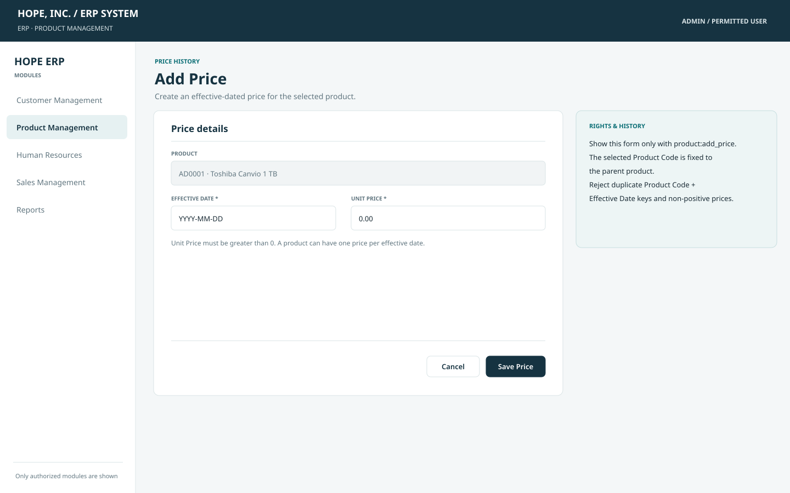
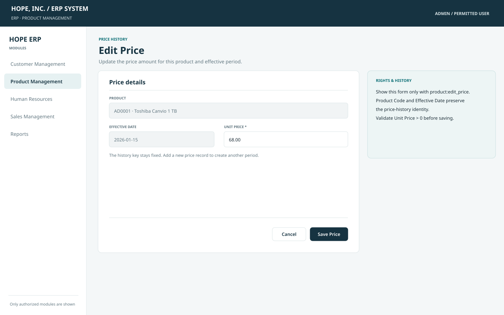

# S2-UIX-02 — Product and Price History wireframes

**Issue:** [#158 — Wireframes: product and price history screens](https://github.com/zurielzantua/Hope-Inc.-Midterm-Project/issues/158)

## Product screens

### Product List — Admin

[Editable SVG source](s2-product-list-admin.svg)

### Product List — User

[Editable SVG source](s2-product-list-user.svg)

### Add Product

[Editable SVG source](s2-product-add.svg)

### Edit Product

[Editable SVG source](s2-product-edit.svg)

## Price History screens

### Price History — Admin

[Editable SVG source](s2-price-history-admin.svg)

### Price History — User

[Editable SVG source](s2-price-history-user.svg)

### Add Price

[Editable SVG source](s2-price-add.svg)

### Edit Price

[Editable SVG source](s2-price-edit.svg)

## Developer handoff

Product fields are Prod Code, Description and Unit; permitted units are `pc`, `ea`, `mtr`, `pkg` and `ltr`. Current price is the latest active price effective on or before today. Future-dated rows do not replace it; show `—` when no eligible row exists. User views omit soft-deleted records and Status/Stamp. Admin inactive rows are shaded.

Price controls map to existing `add_price`, `edit_price` and `delete_price` rights. Product controls map to `add_product`, `edit_product` and `delete_product`; restore remains an authorized administrative operation. Price editing preserves Product Code and Effective Date as the history identity; use Add Price for a new period.

These wireframes describe the interface only; they do not claim the product or price workflows are implemented or tested.
